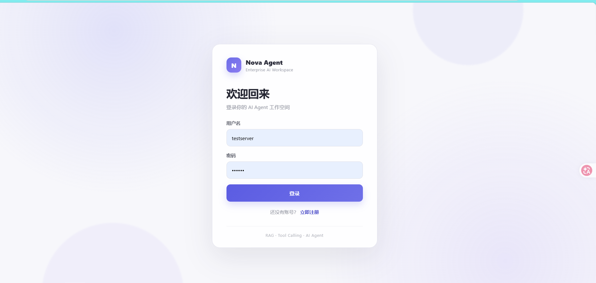
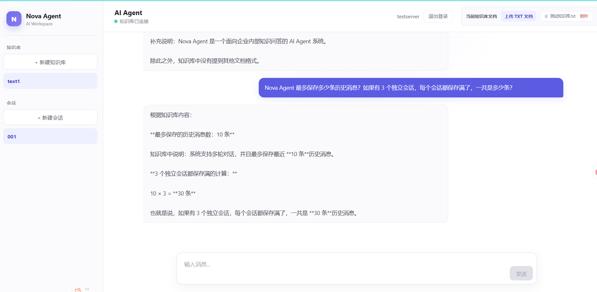

# Nova Agent

企业级 RAG + AI Agent 智能问答平台，基于 **FastAPI + React + FAISS + DeepSeek**。

从「用户登录 → 知识库管理 → 文档上传 → 后台向量化 → 流式问答 → 来源引用」的完整闭环。

## 演示




## 功能特性

**核心问答能力**

- RAG 检索增强生成：文档切分 → Embedding → FAISS 索引 → Top-K 检索 → LLM 生成
- Agent + Tool Calling：`search_knowledge`（知识库检索）、`calculator`（安全数学计算，AST 白名单，无 `eval`）
- 流式回答（SSE）：逐字输出，展示工具调用过程与回答来源
- 多轮对话：会话历史自动携带，回答可追溯到具体文档

**知识库管理**

- 多知识库、多文档，用户数据严格隔离
- 支持 TXT / Markdown / CSV 上传，可在线查看文档索引状态
- 文档上传后**后台异步重建索引**，接口秒回，前端轮询状态
- 索引文件原子写入，多文档并发重建串行化，避免损坏

**企业级基础设施**

- JWT 双 Token（Access + Refresh），前端 401 自动刷新，环境变量密钥
- 统一配置中心（`.env`），所有参数可环境变量覆盖
- 结构化日志 + 请求 ID 全链路追踪 + 按天轮转日志文件
- 内存滑动窗口限流（按用户 / IP），可配置
- 统一错误响应与全局异常兜底，健康检查 `/health` 包含组件状态
- 审计日志（登录、删除知识库、Coding Agent 操作）
- 数据库自动增量迁移，启动即升级，旧数据无损
- CORS 白名单、密码强度校验、用户名规则校验
- 内置 `/docs` 交互式 API 文档

**安全设计（重要）**

- `calculator` 使用 AST 白名单计算器，阻断 `().__class__` 等逃逸手法
- 文件类工具使用 `commonpath` 路径校验 + 敏感文件黑名单（`.env`、数据库、密钥不可读）
- Coding Agent 默认**关闭**，且仅管理员可用（`CODING_AGENT_ENABLED=true` 开启），
  因为它涉及在服务器上读写文件、执行测试，等同于代码执行权限
- 所有接口校验资源归属，A 用户无法访问 B 用户的知识库 / 会话

## 快速开始

```bash
# 1. 配置环境变量
cp .env.example .env        # 填入 DEEPSEEK_API_KEY，生产环境务必改 SECRET_KEY

# 2. 安装依赖（建议 Python 3.10+）
python -m venv .venv
.venv\Scripts\activate      # Linux: source .venv/bin/activate
pip install -r requirements.txt

# 3. 启动后端（首次启动会下载 Embedding 模型）
python api.py               # 默认 0.0.0.0:8000

# 4. 启动前端（开发模式，已配置代理）
cd frontend
npm install
npm run dev                 # http://localhost:5173
```

生产环境构建前端：

```bash
cd frontend
npm run build               # 产物在 frontend/dist
```

## 环境变量

全部配置见 [.env.example](.env.example)，常用项：

| 变量 | 说明 | 默认值 |
| --- | --- | --- |
| `SECRET_KEY` | JWT 签名密钥，生产必须修改 | 开发默认值 |
| `DEEPSEEK_API_KEY` | DeepSeek API 密钥 | 空 |
| `LLM_MODEL` | 对话模型 | `deepseek-v4-flash` |
| `CODING_AGENT_ENABLED` | 是否开启 Coding Agent | `false` |
| `CORS_ORIGINS` | 允许的前端来源（逗号分隔） | 本地开发来源 |
| `RATE_LIMIT_*` | 每分钟限流数量与窗口 | 60 / 60s |
| `MAX_UPLOAD_SIZE_MB` | 单文件上传上限 | 10 |

前端构建时可通过 `frontend/.env` 的 `VITE_API_BASE_URL` 指定后端地址；
不配置则默认同源（由 Nginx 反代）。

## API 一览

| 方法 | 路径 | 说明 |
| --- | --- | --- |
| POST | `/register` `/login` `/refresh` | 注册、登录、刷新 Token |
| GET | `/users/me` | 当前用户信息 |
| GET/POST/DELETE | `/knowledge-bases` | 知识库管理 |
| GET | `/knowledge-bases/{id}/index-status` | 索引构建状态 |
| POST/GET/DELETE | `/knowledge-bases/{id}/documents...` | 文档管理 |
| POST/GET/DELETE | `/conversations...` | 会话管理 |
| GET | `/conversations/{id}/messages` | 消息分页查询 |
| POST | `/chat` | 对话（非流式） |
| POST | `/chat/stream` | 对话（SSE 流式，推荐） |
| POST | `/coding-agent` | 编码任务（管理员 + 开关） |
| GET | `/health` | 健康检查 |

## 部署到服务器（Nginx + systemd）

1. 后端以 systemd 服务运行：`uvicorn api:app --host 127.0.0.1 --port 8000 --workers 2`
2. 前端 `npm run build` 后把 `frontend/dist` 交给 Nginx 托管
3. Nginx 将 `/` 指向前端静态文件，其余接口反代到 `127.0.0.1:8000`：

现成配置见 [deploy/nginx.conf](deploy/nginx.conf)，可直接复制到
`/etc/nginx/sites-enabled/` 使用。

```nginx
server {
    listen 80;
    server_name your-domain.com;

    root /var/www/nova/dist;
    index index.html;

    location / {
        try_files $uri $uri/ /index.html;
    }

    location /register { proxy_pass http://127.0.0.1:8000; }
    location /login { proxy_pass http://127.0.0.1:8000; }
    location /refresh { proxy_pass http://127.0.0.1:8000; }
    location /users { proxy_pass http://127.0.0.1:8000; }
    location /knowledge-bases { proxy_pass http://127.0.0.1:8000; }
    location /conversations { proxy_pass http://127.0.0.1:8000; }
    location /chat { proxy_pass http://127.0.0.1:8000; }
    location /coding-agent { proxy_pass http://127.0.0.1:8000; }
    location /health { proxy_pass http://127.0.0.1:8000; }
}
```

> 流式接口 `proxy_pass` 时建议关闭代理缓冲：`proxy_buffering off;`

## 测试

```bash
python tests/test_unit.py            # 安全边界单元测试（无需网络）
python tests/test_api_smoke.py       # API 全链路冒烟测试（需 DeepSeek Key）
python evaluate.py                   # RAG 检索命中率评测
python run_eval.py                   # 知识库问答 Eval
```

## 项目结构

```text
api.py             FastAPI 路由与业务编排
agent.py           Agent 循环、工具定义、流式输出
rag.py             文档切分、Embedding、FAISS 索引、检索
tools.py           Agent 工具实现（含安全边界）
indexing.py        后台索引任务服务
security.py        JWT、密码、身份依赖、限流
middleware.py      请求 ID 与访问日志中间件
safe_calc.py       AST 安全计算器
database.py        ORM 模型与自动迁移
config.py          配置中心
schemas.py         请求校验模型
frontend/          React + TypeScript 前端
tests/             单元与冒烟测试
```

## 技术栈

后端：FastAPI · SQLAlchemy · FAISS · sentence-transformers · DeepSeek
前端：React 19 · TypeScript · Vite
